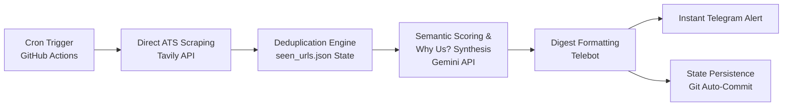

# 💼 Job Hunter Agent: Automated Global SRE & DevOps Career Radar (Zero-Friction)

[](https://github.com/riyankhamdani/job-hunter-agent/actions)
[](https://www.python.org/downloads/)
[](LICENSE)

An autonomous, serverless career scout engineered to eliminate application fatigue for Cloud, DevOps, and Site Reliability Engineers. It filters global remote listings (USD/GBP compensation) and verified visa sponsorship programs, evaluating profile stack compatibility and generating tailor-made ATS questionnaire answers for instant submission.

Powered by Google Gemini API (`google-genai` SDK), Tavily domain-targeted ATS scraping, and scheduled GitHub Actions workflows.

---

## 🏗️ Architecture & Pipeline Flow

The agent runs on a scheduled serverless cron, querying major Applicant Tracking Systems (ATS), deduplicating URLs against git-persisted state, semantically evaluating job specs with Gemini, and dispatching curated digests straight to Telegram.



---

## 🎯 Key Engineering Highlights

- **Zero-Friction "Why Us?" Synthesis:** Automatically extracts company value propositions and crafts hyper-tailored, enterprise-grade application responses grounded in production SRE/Infra experience to compress application time from 20 minutes to seconds.
- **Semantic Profile Match Scoring:** Evaluates tech stack alignment (Kubernetes, AWS/GCP, IaC, High-Availability, CI/CD) and assigns a quantified percentage match (e.g., 95% Match) for instant triage.
- **Compensation & Relocation Intelligence:** Scrapes unstructured job postings to normalize salary bands ($USD/£GBP) and strictly validates genuine visa sponsorship programs (EU, UK, Dubai Hub).
- **Direct ATS Ingestion:** Queries high-intent Applicant Tracking Systems directly (Greenhouse, Lever, Workable, SmartRecruiters), bypassing noisy job boards and regional hiring caps.
- **GitOps State Ledger:** Commits `seen_urls.json` back to repository state on every cron cycle to guarantee zero duplicate alerts.
- **100% Serverless:** Operates with zero hosting or persistent infrastructure costs.

---

## 📱 Live Sample Output (Telegram Notification)

```text
💼 DAILY JOB HUNTER DIGEST (ZERO-FRICTION) 💼
====================================

🌐 LOWONGAN REMOTE GLOBAL (TAP-TO-APPLY)

- 🟢 95% MATCH — Senior Site Reliability Engineer (APAC) - Alpaca
   Remote (APAC) | 💵 Est. Gaji: $90,000 - $130,000 USD / tahun
   📝 Jawaban form ("Why Us?"):
   "Having architected multi-cloud Kubernetes and PostgreSQL platforms for tier-1 financial institutions with 99.9% uptime, I bring direct expertise in scaling trading-critical fintech infrastructure. I am eager to apply my IaC automation and database reliability engineering to ensure Alpaca’s brokerage systems remain seamlessly fault-tolerant."
  
   🔗 Apply: [https://job-boards.greenhouse.io/alpaca/jobs/6186847004](https://job-boards.greenhouse.io/alpaca/jobs/6186847004)

---

✈️ LOWONGAN VISA SPONSOR / RELOKASI

- 🟢 92% MATCH — Site Reliability Engineer - Wheely
   Relokasi (Eropa / Dubai Hub) + Visa Sponsorship | 💵 Est. Gaji: $95,000 - $125,000 USD / tahun
   📝 Jawaban form ("Why Us?"):
   "With proven success managing mission-critical AWS/GCP container ecosystems and reducing infrastructure provisioning time by 60% via Terraform and Ansible, I ensure zero-downtime operations for high-stakes services. I am excited to channel my enterprise resilience and DRC automation experience into scaling Wheely's premium mobility architecture."
  
   🔗 Apply: [https://job-boards.greenhouse.io/wheely/jobs/7588282003](https://job-boards.greenhouse.io/wheely/jobs/7588282003)

- 🟢 88% MATCH — Cloud Infrastructure Engineer - Loft Orbital Solutions
   Relokasi (Toulouse, Prancis) + Visa Sponsorship | 💵 Est. Gaji: $85,000 - $115,000 USD / tahun
   📝 Jawaban form ("Why Us?"):
   "I specialize in building hardened multi-cloud infrastructure and automated Kubernetes platforms maintaining 99.9% service availability under strict audit standards. Joining Loft Orbital allows me to combine my deep IaC automation skills with mission-critical container operations to deliver rock-solid ground cloud infrastructure for space missions."
  
   🔗 Apply: [https://jobs.lever.co/loftorbital/efdac766-7662-4760-8a46-265f076d9e01/apply](https://jobs.lever.co/loftorbital/efdac766-7662-4760-8a46-265f076d9e01/apply)
```

---

## 🛠️ Tech Stack

- **Runtime:** Python 3.11+
- **LLM Reasoning:** Google Gemini API (`google-genai` SDK)
- **Scraping & Discovery:** Tavily Search API (Domain-targeted ATS filters)
- **Orchestration:** GitHub Actions (`job_agent.yml`)
- **Notification Service:** Telegram Bot API (`pyTelegramBotAPI`)
- **State Store:** Git-persisted JSON (`seen_urls.json`)

---

## ⚙️ Environment Configuration

Configure the following secrets in GitHub Repository Settings (`Settings -> Secrets and variables -> Actions`):

| Secret Name | Description |
|---|---|
| `GEMINI_API_KEY` | Google AI Studio API Token |
| `TAVILY_API_KEY` | Tavily Search API Token |
| `TELEGRAM_BOT_TOKEN` | Bot API Token from `@BotFather` |
| `TELEGRAM_CHAT_ID` | Telegram User or Channel ID |

---

## 🚀 Local Execution

```bash
# Clone repository
git clone [https://github.com/riyankhamdani/job-hunter-agent.git](https://github.com/riyankhamdani/job-hunter-agent.git)
cd job-hunter-agent

# Install dependencies
pip install -r requirements.txt

# Run manual cron mode
export GEMINI_API_KEY="your-gemini-key"
export TAVILY_API_KEY="your-tavily-key"
export TELEGRAM_BOT_TOKEN="your-bot-token"
export TELEGRAM_CHAT_ID="your-chat-id"

python agent.py --cron
```
